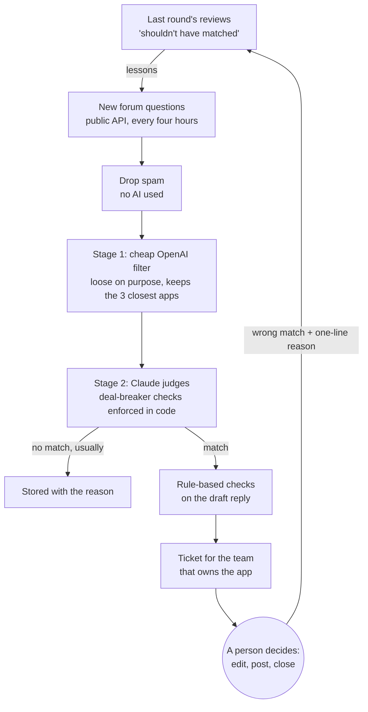

# Forum Answer Engine

<!-- COVER IMAGE: an anonymised diagram or a redacted screenshot of a routed ticket.
     Save it as docs/cover.png in the repo, then replace this comment with:
     
     Before you publish one, check it shows no app names, forum usernames or company branding. -->

**A system that reads a busy product forum every few hours, finds the questions one of our apps
genuinely solves, drafts a reply, and puts it in front of the marketer who owns that app. A person
reviews and posts every reply.**

> I built this for my employer, and the real code belongs to them. This repo explains what I built
> and how it works, without naming the company, the platform or the apps. The [`example/`](example/)
> folder is a small, runnable version of the matching pipeline that I wrote from scratch on invented data.

## Why it exists

I work in marketing for a vendor with a large portfolio of apps for one software platform. The
platform has a big public forum, full of people describing problems our apps solve.

In 2024 I tested whether that was a real channel by answering questions by hand, two or three a week
for one app. Over ten months those answers drove **16.8% of that app's marketplace traffic**. So the
channel was real. But hundreds of questions go up every day, and nobody had time to read them.

An earlier attempt to find those questions automatically had failed in two ways:

1. **Too many false positives.** About 9 in 10 suggested matches were wrong.
2. **No way to triage them.** Suggestions landed in one shared channel with no owner, so people
   stopped looking.

Every design choice below answers one of those two failures.

## How it works



- **Two stages, cheap then smart.** Every question gets an OpenAI embedding and is compared with every
  app in the catalog, for a fraction of a cent. The filter is loose on purpose: its job is never to
  lose a real match. Only the survivors, with their three closest apps, go to Claude.
- **The judge is allowed to say no, and usually does.** Claude reads the question, the replies
  already posted and the three candidate apps. Before it scores a match, it answers a fixed list of
  yes/no deal-breaker questions. If any answer is yes, the code throws the match out, however confident the model
  sounds.
- **Matches become tickets, not chat messages.** Each one lands in the issue tracker the owning team
  already uses, with an owner, a due date, the matched app, Claude's reasoning, the existing replies,
  a draft answer and a short checklist to go through before posting.
- **It learns from its mistakes.** When a reviewer closes a ticket as "shouldn't have matched" with a
  one-line reason, the next run turns that into a lesson. Low-risk lessons apply automatically;
  riskier ones wait for a person to approve them.
- **A person always decides.** The engine never posts anything. A bot posting replies on a product
  forum would be spam, however good the replies. The engine does the part no one had time for,
  reading everything, and a person does the part that needs judgment.

## Try it

[`example/`](example/) runs the pipeline on 14 invented forum questions, half of them traps, and
reports what it got right. It runs offline, or with OpenAI and Claude if you set API keys.

```bash
cd example && npm install && npm run test-set
```

## How I built it

**A test set before the engine.** Before writing any of the engine, I collected about 80 real forum
questions, roughly half that should match one of our apps and half that shouldn't, each with the
expected app and the reason. I included traps on purpose, like a bug report about one of the
platform's built-in features that looks like a match but isn't. Every change since has been run
against this set, so a fix that breaks something else shows up before it ships.

**A product catalog written for the machine, not for buyers.** Each app's entry describes the
problem it solves (not its feature list), where it runs, the phrases people actually use on the forum
when they have that problem, and what the platform already does natively, so the engine doesn't push
an app where a built-in feature is enough.

**Rules that matter live in code.** I improved the engine in rounds: review a batch of wrong tickets,
find the root cause of each, fix it in the catalog, the instructions or the code, and add the
question to the test set. One lesson kept repeating. Telling the model more firmly in words wasn't
reliable enough, so the most important rules are now enforced in code.

**Every decision is measured.** Each suggested link carries a tag unique to its question. A dashboard
built on the company's analytics shows questions processed, matches, answers posted, marketplace
clicks and trials started. A separate admin page shows AI spend and anything waiting for a decision.
Rejected questions are stored too, with the reason, which makes tuning much easier.

## Built with

| Piece | Built with |
|---|---|
| Engine and dashboard | TypeScript on Node.js, Next.js and React |
| Database | PostgreSQL |
| Stage 1 filter | OpenAI embeddings |
| Stage 2 judge | Claude, through Anthropic's API |
| Tickets | The issue tracker's API |
| Login | The company's single sign-on |
| Hosting and scheduling | Internal app hosting, a run every four hours |
| Code and reviews | GitHub, with automated tests and code review on every change |

It started from the company's starter template for internal apps, which supplied the login, hosting
and deployment setup. I built the engine logic, the product catalog and the test set.

## Results so far

| Stage | Count |
|---|---|
| Questions read | ~4,800 |
| Matched to an app | 164 (about 3.4%) |
| Clicks through to the marketplace | 67 |
| Trials started | 1 |

The top of the funnel works: the engine says "no match" to about 97 questions in 100, which is the
opposite of the old 9-in-10 false positives. The bottom of the funnel is the weak part. Finding the
questions used to be the bottleneck. Now it's a person finding time to post the reply.

## Lessons you can reuse

1. **Prove the channel by hand first.** I didn't automate anything until ten months of manual
   answers had shown the channel was worth it.
2. **Build the test set before the product.** It turns "seems to work" into something you can prove.
3. **Run a cheap filter first, and let the AI say no.** Forcing a match is how you get 90% false
   positives.
4. **Enforce the rules that matter in code, not in wording.**
5. **Automating one step moves the bottleneck.** The engine showed which step was really the
   constraint, but it can't staff it.

Happy to go through it in more depth in conversation.
